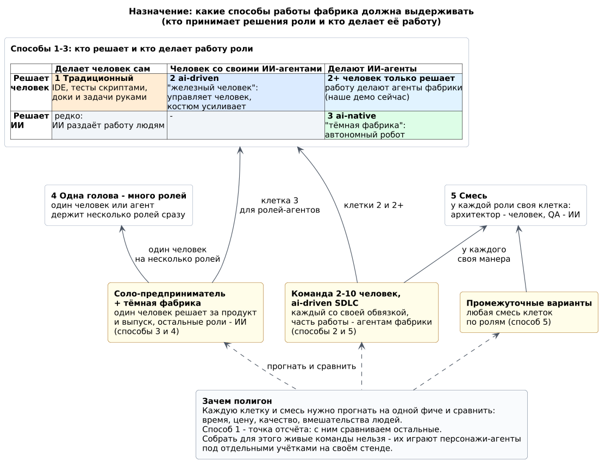
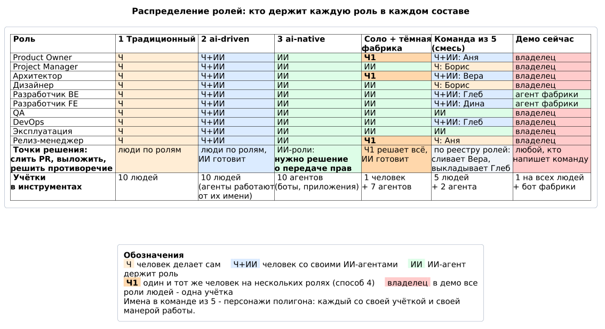
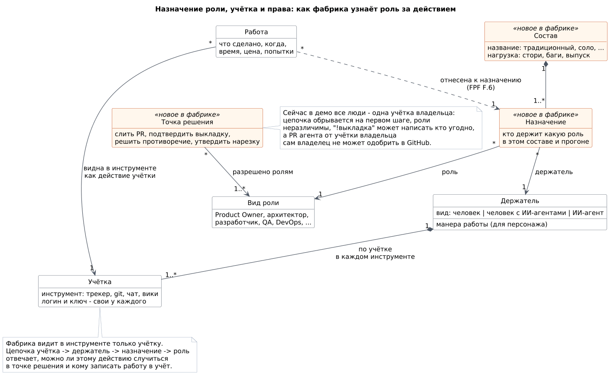
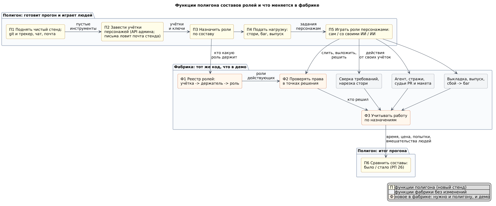
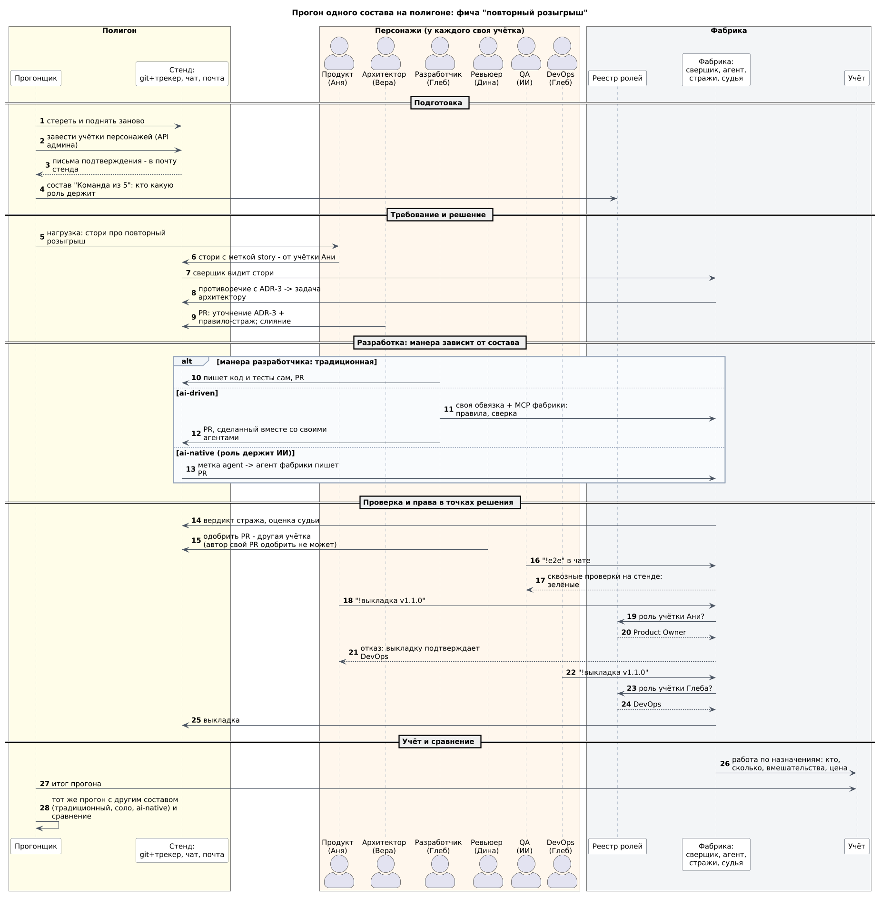
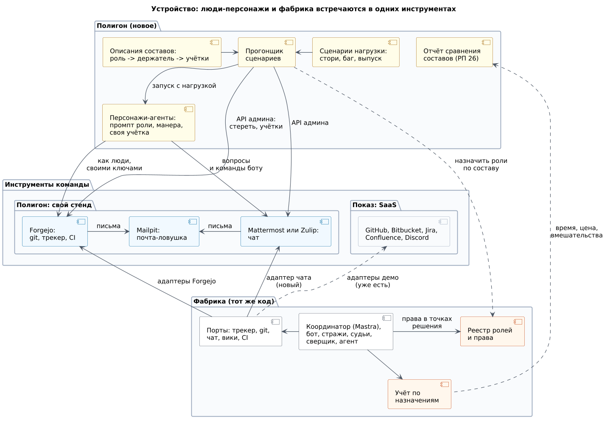
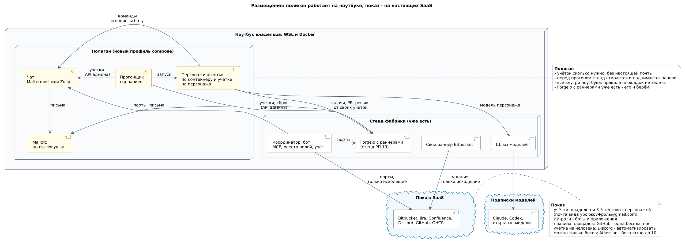

# Полигон составов ролей (предложение)

Статус: принято 15.10.2026. Реестр ролей с правами в точках решения уже работает (`.factory/roles.yml` цели, [platforms.md](../demo/platforms.md)); полигон, персонажи и прогоны составов - следующий шаг.

Роли разработки (продукт, архитектор, разработчик, QA, DevOps и другие) может держать человек, человек со своими ИИ-агентами или ИИ-агент, а один держатель может держать несколько ролей. Фабрика должна работать при любом таком составе: от команды людей, работающих по-старому, до соло-предпринимателя с "тёмной фабрикой". Полигон - свой стенд, где составы играют персонажи-агенты под отдельными учётками: один и тот же сценарий прогоняется разными составами, и они сравниваются по времени, цене, качеству и вмешательствам людей.

## Точки зрения и виды

Каждая диаграмма - вид под своей точкой зрения: кто его читает, на какой вопрос отвечает и что обязан показать (FPF E.17.0). Четыре инженерные точки зрения - функции, порядок, распределение ответственности, устройство - взяты по шаблону TEVB (FPF E.17.2); назначение и размещение добавлены отдельно.

| Точка зрения | Кто читает | Вопрос | Вид обязан показать | Вид |
|---|---|---|---|---|
| Назначение | владелец, продукт фабрики | какие способы работы фабрика должна выдерживать и где наша аудитория | кто решает и кто делает работу роли; способы 1-5; аватары аудитории; место демо | [roles-purpose](diagrams/roles-purpose.png) |
| Распределение ролей | архитектор, PM | кто держит каждую роль в каждом составе и кто решает в точках решения | роли и составы; вид держателя в каждой клетке; права в точках решения; число учёток | [roles-compositions](diagrams/roles-compositions.png) |
| Назначение и учётка | архитектор фабрики | как фабрика узнаёт роль за действием | цепочка учётка -> держатель -> назначение -> роль; точка решения требует роль; работа отнесена к назначению (FPF A.2.1, F.6) | [roles-assignment](diagrams/roles-assignment.png) |
| Функции | архитектор, разработчик полигона | что делает полигон и что меняется в фабрике | функции полигона; функции фабрики без изменений; новое в фабрике | [roles-functions](diagrams/roles-functions.png) |
| Порядок | QA фабрики, разработчик полигона | как идёт один прогон | шаги по ролям; три манеры разработчика; отказ в праве; учёт; повтор другим составом | [roles-run](diagrams/roles-run.png) |
| Устройство | разработчик фабрики | из чего собран полигон и через какие интерфейсы он работает с фабрикой | модули полигона; порты; носители полигона и показа; что новое | [roles-modules](diagrams/roles-modules.png) |
| Размещение | DevOps, владелец | где всё работает и почему полигон не задевает правил площадок | Docker ноутбука (полигон и стенд фабрики), SaaS показа, учётки и их число, исходящие соединения | [roles-deployment](diagrams/roles-deployment.png) |

Правила площадок на диаграммах (одна бесплатная учётка GitHub на человека, автоматизация в Discord только ботами, бесплатный Atlassian до 10 пользователей) записаны по памяти - сверить по их условиям при старте работы.

## Назначение

## Распределение ролей

## Функции

## Порядок

## Устройство

## Размещение

## Решение 16.10.2026: видео-демо - состав 3

- Проблема: решения в точках решения принимал человек вживую - каждый дубль видео требовал владельца, перевыпуск одной командой не получался.
- Решение: в видео все роли играют ИИ-персонажи. На стенде демо (реестр ролей prize-draw) каждый персонаж держит человеческую роль своей области и принимает её решения: PO - стори и утверждение нарезки, Architect - правила и ADR, Backend - отдать задачу агенту и слить PR, DevOps - выкладка и выпуск. Роли-помощники `<роль>-ai` остаются для назначения задач агента. Реплики и правки персонажей заданы сценарием съёмки (`docs/demo/film.yml`), работу фабрики делает ИИ вживую.
- Почему: состав 3 - один из способов работы, которые фабрика должна выдерживать; отдельный ИИ-дублёр владельца не нужен, а решения у ролей своей области показывают команду честнее одного решающего.
- Последствия: в GitHub персонажи действуют приложениями GitHub (условия GitHub дают человеку одну бесплатную служебную учётку); в начале видео сказано, что все роли играют ИИ-персонажи, а кто решает в живой команде, задаёт реестр ролей. Отказ самозванцу (вебхук без учётки) остаётся.
- Пересмотр: когда стенд демо понадобится для прогона с людьми (составы 1 и 2) - человеческие роли вернуть людям.

## Опора на FPF

| Паттерн | Где | Как использован |
|---|---|---|
| A.2.1 Назначение на системную роль | FPF-Spec.md:3974 | состав - набор назначений держателей на роли; держатель - человек, человек с ИИ-агентами или ИИ-агент |
| F.6 Отнесение работы к назначению | FPF-Spec.md:107560 | работа в учёте относится к назначению, а не к учётке; без отдельных учёток отнести нельзя |
| E.17.0 Точки зрения и виды | FPF-Spec.md:94089 | у каждой диаграммы - точка зрения: читатель, вопрос, что вид обязан показать |
| E.17.2 TEVB | FPF-Spec.md:95070 | четыре инженерные точки зрения: функции, порядок, распределение ответственности, устройство |
