# Демо фабрики ПО на ИИ: архитектура и этапы

Состояние разработки (FPF B.5.1): **оформление (Shaping)** - направление выбрано владельцем 14.10.2026, проверки на стенде впереди. Это описание - план, а не сделанная работа (FPF A.15.2): готовность подтверждают признаки из раздела 10.

Демо стенда 14.10 на todo list - [../demo.md](../demo.md); оно остаётся запасным показом.

## 1. Что показываем и кому

Описание использования и системы вместе (FPF SYSE.2:4.3):

- **Использование.** Команда заказной разработки (продукт, архитектор, дизайнер, разработчики, QA, DevOps, эксплуатация, релиз) видит одну новую фичу целиком: каждая роль работает в привычном инструменте и в своём экзокортексе, а фабрика проверяет результат стражами правил и управлением.
- **Система.** Фабрика - система создания других систем. Её экземпляр в демо живёт на Bitbucket + Pipelines, целевая система - на GitHub + Actions; трекер, вики и чат - Jira, Confluence, Discord, как в будущем пилоте.
- **Главная неопределённость.** Проходит ли сквозная связка "задача Jira -> координатор -> задание Bitbucket на своём раннере -> агент по подписке -> PR в GitHub -> стражи" без входящих соединений к ноутбуку и без права записи у агента.
- **Вопрос архитектуры.** Достаточно ли портов (трекер, хостинг, CI, выкладка, знания), чтобы платформа фабрики и платформа цели менялись независимо.
- **Пересмотр.** Владелец меняет пилот или инструменты; связка не проходит на стадии 3.

## 2. Целевая система: Розыгрыш призов

Простое приложение "фронтенд + бэкенд", где у каждой роли есть естественная работа и есть бизнес-правила, на которых видны стражи и конфликты знаний. Выбор владельца 14.10.2026; запасной вариант - бронирование переговорных.

| Что | Как |
|---|---|
| Пользователи | участник подаёт заявку, смотрит результаты, подтверждает получение приза; организатор создаёт розыгрыш и запускает выбор победителей |
| Фронтенд | TypeScript, React, Vite: активные розыгрыши, заявка, результаты с проверкой честности, кабинет организатора |
| Бэкенд | TypeScript, NestJS, PostgreSQL: розыгрыши, заявки, победители, объявления в Discord |
| Правила | R1 одна заявка от участника на розыгрыш; R2 заявки только в период розыгрыша; R3 участнику 18+; R4 победители выбираются детерминированно из зерна, хэш которого опубликован до конца приёма заявок, - результат может пересчитать любой; R5 не больше одного приза одному участнику в розыгрыше; R6 приз подтверждают за 3 дня, иначе он не востребован |
| Фича демо | повторный розыгрыш невостребованного приза |
| Репозиторий и платформа | github.com/ypolosov/prize-draw: GitHub + Actions - сборка, тесты, e2e (Playwright), образы в GHCR; стенд - docker compose на ноутбуке |

Фича задевает всех: продукт хочет "разыграть приз заново среди всех", а это спорит с решением архитектора о воспроизводимом результате (R4, ADR-3); архитектор решает - повтор берёт следующего кандидата из той же последовательности - и добавляет правило-страж; дизайнер рисует экран невостребованного приза; разработчики меняют API и экран; QA пишет e2e "повтор детерминирован, победитель не повторяется"; DevOps настраивает задание проверки сроков; эксплуатация ловит сбой повторного розыгрыша; релиз выпускает версию 1.1.0.

### Роли в демо

| Роль | Инструмент | Шаг в демо | Режим |
|---|---|---|---|
| Product Owner | Discord, Confluence | спрашивает бота о невостребованных призах; пишет стори про повторный розыгрыш; получает конфликт и решение (UC1) | HITL |
| Project Manager | Jira, Discord | заметки к дейли из журнала Jira; утверждает нарезку эпика агентом; ставит приоритет бага (UC2, UC6) | HOTL |
| Архитектор | свой экзокортекс, GitHub | решает конфликт: PR с уточнением ADR-3 и правилом-стражем; утверждает правило-кандидат (UC1, UC7) | HITL |
| Дизайнер | Figma | экран невостребованного приза и страница результатов; судья сверяет макет с требованиями (UC3) | HOTL |
| Разработчик BE | Claude Code + MCP фабрики | спецификация и сценарии приёмки с агентом; метка agent; ревью PR API (UC4) | HITL, HOOTL |
| Разработчик FE | Codex или Cursor + MCP фабрики | то же для экрана: другой экзокортекс, те же стражи (UC4) | HITL, HOOTL |
| QA | GitHub, Discord | сценарии приёмки -> e2e; просит бота перезапустить e2e; проверяет баг (UC4, UC6) | HOTL |
| DevOps | GitHub, Discord | задание проверки сроков подтверждения, конфигурация выкладки; подтверждает выкладку (UC5) | HITL |
| Эксплуатация | Discord | получает сбой повторного розыгрыша, спрашивает бота о связанных PR (UC6) | HOTL |
| Релиз-менеджер | Discord, GitHub | черновик заметок о выпуске от бота; тег v1.1.0 (UC5) | HITL |

Агенты фабрики: библиотекарь (сбор и выдача знания), сверщик (конфликты, правила-кандидаты), исполнитель (тесты и код), судья-ревьюер (модель другого семейства). Координатор - не агент, а процесс с фазами.

## 3. Две оси платформ

| Ось | Что на ней | В демо | Другие носители |
|---|---|---|---|
| Платформа фабрики | где живёт экземпляр фабрики и идут её задания | Bitbucket + Pipelines, свой раннер | GitHub + Actions (разработка самой фабрики), GitLab + CI, Forgejo + Actions |
| Платформа цели | где живёт код цели и её CI/CD | GitHub + Actions, GHCR | у пилота - Bitbucket + Argo Workflows |

Фабрика работает с целью только через порты: трекер, хостинг, CI, выкладка, знания. Свои задания она запускает на своей платформе, а не в CI цели.

## 4. Функции

Отвечает на вопрос: какие функции нужны и в каком режиме автономии (FPF SYSE.5: сначала функции, потом носители).

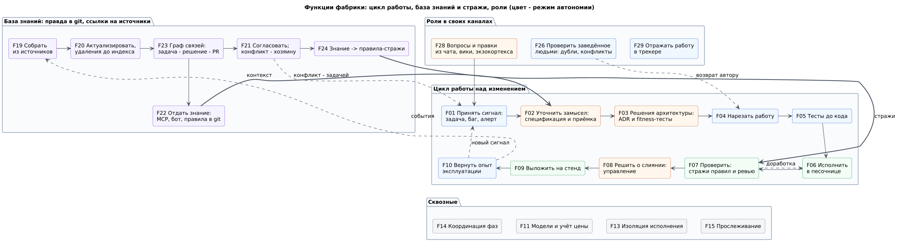

Носители функций в демо (связь функций и контейнеров - многие ко многим):

| Функции | Носитель |
|---|---|
| F01 Принять сигнал, F14 Координация | координатор (опрос Jira), мост сбоев |
| F02 Уточнить замысел, F03 Решения архитектуры | экзокортекс человека + MCP фабрики; результат - PR в репозиторий цели |
| F04 Нарезать работу, F26 Проверить заведённое | задания фабрики -> Jira через порт трекера |
| F05 Тесты до кода, F06 Исполнить, F13 Изоляция | задания фабрики на своём раннере, образ исполнителя, прокси выхода |
| F07 Проверить | CI цели (Actions) + стражи (задания фабрики) + судья |
| F08 Решить о слиянии | человек в GitHub по политике из правил; координатор ждёт |
| F09 Выложить, F10 Вернуть опыт | выкладка (deployer), Gatus, GlitchTip, мост сбоев |
| F11 Модели, F15-F16 Прослеживание и учёт | шлюз моделей, ключ задачи везде, отчёт учёта |
| F19-F23 База знаний | сборщики, база знаний (Onyx на переходе), сверщик |
| F24 Знание -> правила | сверщик -> PR в правила; стражи читают правила |
| F22, F28, F29 Выдача и каналы | MCP фабрики, бот Discord, навык экзокортекса для трекера |

## 5. C4 L1 - контекст

Отвечает на вопрос: кто работает с фабрикой и с какими системами она связана.

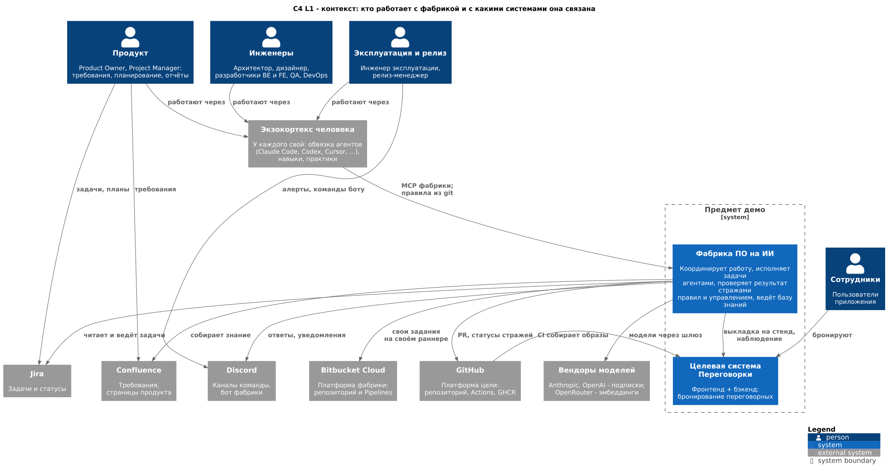

## 6. C4 L2 - контейнеры фабрики

Отвечает на вопрос: из каких частей собрана фабрика и через что они общаются.

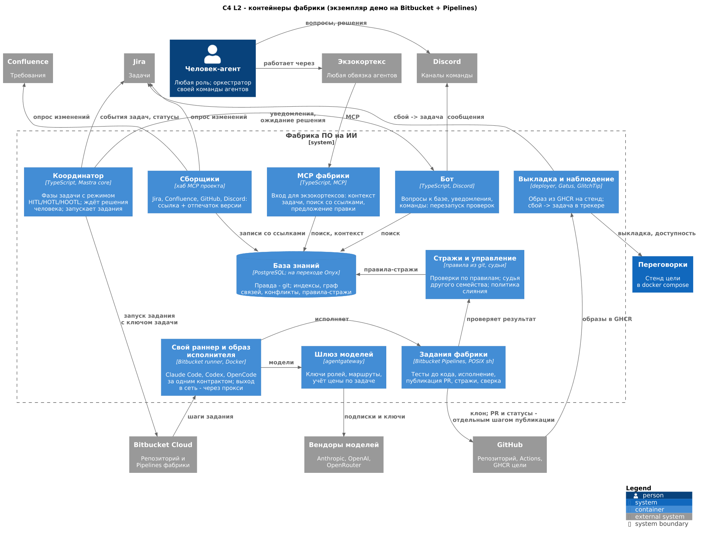

- Исполнитель - наш образ с Claude Code, Codex и OpenCode за одним контрактом в обычном шаге Bitbucket Pipelines. Агентные шаги Bitbucket (Agentic Pipelines, бета) не берём: они привязаны к одной платформе, а контракт исполнителя переносится на любую.
- Агент шага не имеет права записи: PR и статусы публикует отдельный шаг с токеном публикации и без ключа модели.
- Стражи - детерминированные проверки по правилам из git цели плюс судья другого семейства моделей. Вердикт - статус коммита `factory/verdict` и комментарий: так он виден в PR любой платформы (у Bitbucket нет меток на PR).

## 7. C4 L2 - контейнеры цели

Отвечает на вопрос: что именно создаёт фабрика в демо.

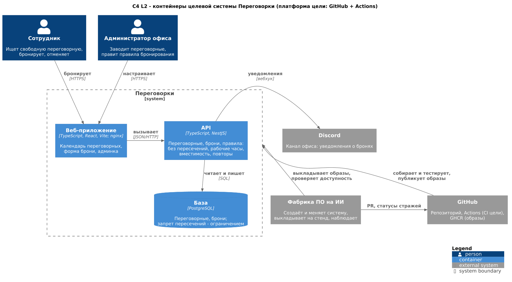

## 8. Развёртывание

Отвечает на вопрос: где что работает и какие соединения нужны.

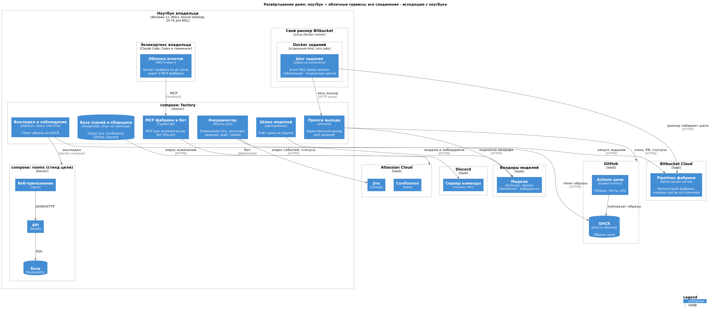

- Все соединения исходящие: координатор опрашивает Jira вместо вебхуков, раннер сам забирает шаги из Bitbucket, бот держит соединение с Discord. Туннель для вебхуков - позже, если задержка опроса (15-30 с) помешает.
- Задания исполняются в отдельном Docker с сетью только через прокси выхода; Docker API хоста им недоступен.
- Секреты - только в `.state/`; токены с минимальными правами: агенту - чтение репозитория цели, шагу публикации - запись PR и статусов.
- Память: Onyx берёт до 10 ГБ; при нехватке 24 ГБ WSL его профиль выключается вне показа.

## 9. Основные сценарии

Отвечает на вопрос: кто что делает и где участвуют агенты.

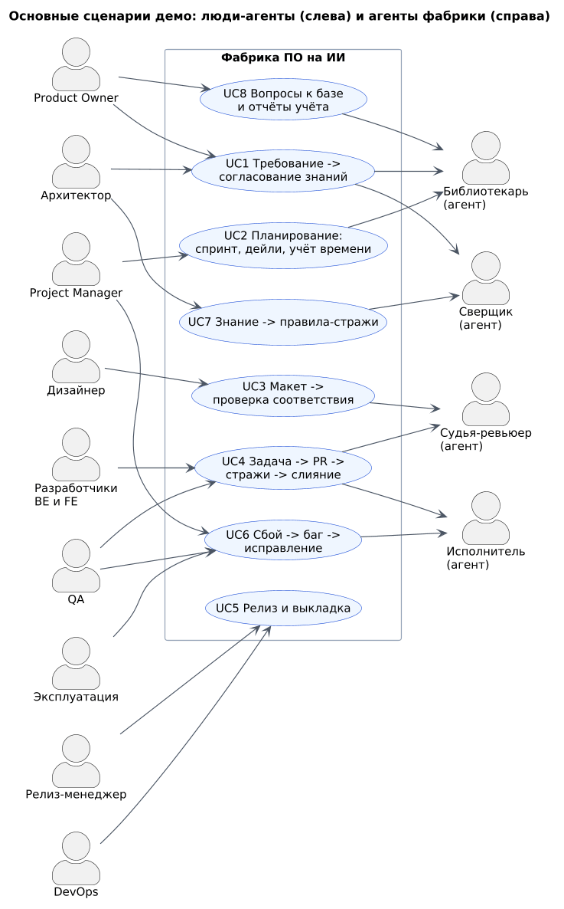

UC2 (планирование, дейли, учёт времени), UC3 (макет) и UC8 (вопросы и отчёты) - короткие шаги в таблице ролей; подробно - пять сценариев ниже.

### UC4 Задача -> PR -> стражи -> слияние

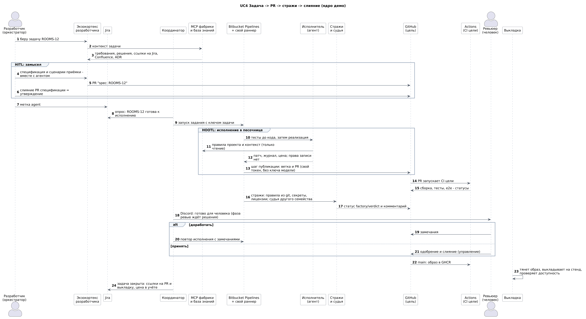

### UC1 Требование -> согласование знаний -> решение архитектора

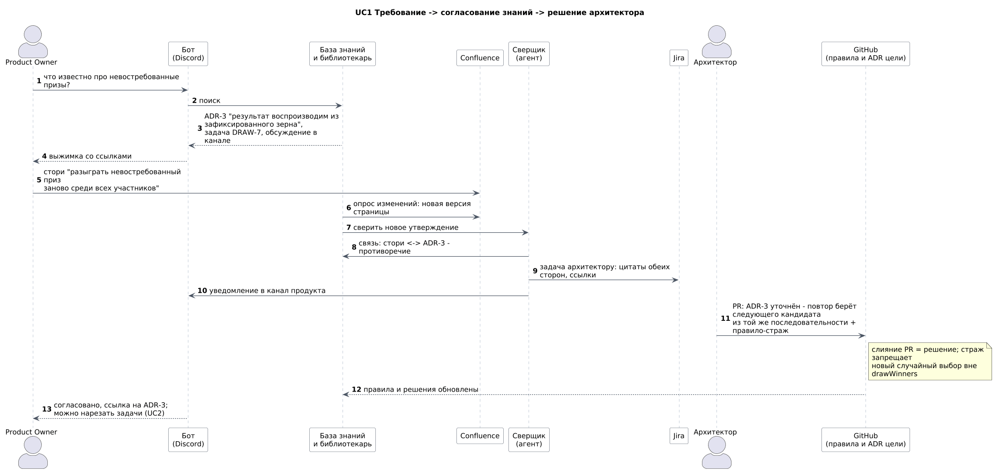

### UC7 Знание -> правила-стражи

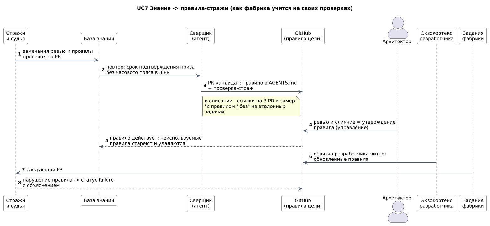

### UC6 Сбой -> баг -> исправление

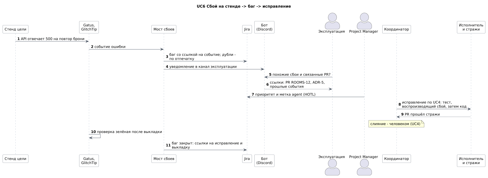

### UC5 Релиз и выкладка

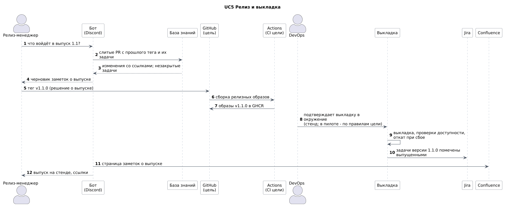

## 10. Определение готовности (DoD)

Критерии проверяются по фактам после работы, а не по описанию (FPF A.2.3); каждый вопрос ловит свой пропуск (FPF CHK.1).

### Изменение через фабрику

| Вопрос | Пропуск, который он ловит |
|---|---|
| Есть ли утверждённые человеком спецификация и сценарии приёмки - слитый PR со ссылкой на задачу? | агент строит не то |
| Написаны ли тесты из сценариев до кода и падали ли они сначала? | тесты подогнаны под код |
| Зелёный ли CI цели: сборка, линтер, проверка форматирования, типы, архитектурные проверки, модульные тесты, e2e? | сломанная или неряшливая сборка дошла до ревью |
| Пройдены ли стражи: правила из git, секреты, лицензии, судья; вердикт - статусом и комментарием? | нарушение правила видно только людям |
| Одобрил и слил ли человек-владелец области (автослияние - только механических правок по политике)? | решение без ответственного |
| Выложено ли на стенд и зелёная ли проверка доступности? | слито, но не работает |
| Сверены ли затронутые документы базы с кодом; противоречия заведены задачей? | знание расходится с кодом |
| Есть ли ключ задачи в ветке, коммитах, PR и выкладке; закрыта ли задача со ссылками? | разорванная цепочка прослеживания |
| Записаны ли цена, время по участкам и число попыток? | польза фабрики не измерима |

### Демо целиком (приёмка владельцем)

1. Сценарий проходит на платформах: фабрика - Bitbucket + Pipelines со своим раннером, цель - GitHub + Actions; Jira, Confluence, Discord.
2. У каждой из десяти ролей есть свой шаг в привычном инструменте; работа агентов (библиотекарь, сверщик, исполнитель, судья) видна в журнале прогона.
3. Два разных экзокортекса (например, Claude Code и Codex) работают через MCP фабрики, и их результат проходит одних и тех же стражей.
4. Агент исполняет задачу по подписке на своём раннере; попытка пушить из шага агента отклонена.
5. Конфликт требования с решением архитектора найден автоматически и ушёл задачей; после решения страж ловит нарушение нового правила.
6. Правило-кандидат из повторяющихся замечаний предложено PR и после утверждения применяется стражем.
7. Сбой на стенде заводит баг в Jira со ссылкой на событие, без дублей; исправление проходит весь цикл.
8. Выпуск v1.1.0: тег -> образы -> стенд; заметки о выпуске в Confluence.
9. Отчёт учёта: цена, время и попытки по каждому изменению демо.
10. Входящих соединений к ноутбуку нет; секреты только в `.state/`.
11. Владелец принял прогон (FPF SYSE.14: решение о выпуске за названным агентом).

## 11. Этапы работ

Порядок - от самого рискованного взаимодействия к остальному: сначала сквозной скелет на пустой цели, потом наполнение (FPF SYSE.11:4.1.1). Зависимости названы, остальное идёт параллельно (FPF SYSE.20).

| # | Стадия | Вход | Действие | Выход | Условие продолжения | Оценка |
|---|---|---|---|---|---|---|
| 1 | Архитектура и план | решения 14.10, каталог ролей | это описание: функции, C4, развёртывание, сценарии, DoD, этапы | `docs/demo/` | владелец принял архитектуру и оценку | 3 ч, сделано |
| 2 | Платформы | учётки владельца (внешний) | Bitbucket: рабочее пространство, репозиторий фабрики, свой раннер; GitHub: репозиторий цели; Jira, Confluence, Discord; токены в `.state/` | платформы доступны | пустой шаг прошёл на своём раннере; задача Jira и PR в GitHub созданы через порты | 2 ч, сделано |
| 3 | Сквозной скелет | 2; адаптеры Jira, GitHub, Bitbucket (РП 23); координатор (РП 24) | задача Jira с меткой -> координатор -> задание на своём раннере -> агент по подписке -> PR в GitHub -> статус стража | один сквозной прогон | PR и статус есть; пуш из шага агента отклонён; нет - разобрать звено и повторить | 10 ч, сделано: DRAW-1 -> prize-draw#1 |
| 4 | Целевая система | 2 | каркас фронтенда и API, правила R1-R6, CI в Actions, образы в GHCR, compose стенда, выкладка | приложение на стенде | e2e "одна заявка на участника" и "результат воспроизводим из зерна" зелёные; слияние выкладывается само | 6 ч, сделано: prize-draw 50f68b0 выложен сам |
| 5 | База знаний и стражи | 2, 4 | сборщики Jira, Confluence, GitHub, Discord (Onyx на переходе); правила и ADR в репозитории цели; стражи; MCP фабрики; сверщик | ответы со ссылками, стражи в задании | вопрос в Discord и из экзокортекса - ответ со ссылками; страж ловит нарушение ADR | 8 ч |
| 6 | Роли и каналы | 3, 4, 5 | бот: вопросы, дейли, перезапуск e2e, уведомления; мост сбоев -> Jira; заметки о выпуске; сценарий по ролям | сценарий демо | у каждой роли есть шаг; прогон без ручных правок | 6 ч |
| 7 | Генеральный прогон и приёмка | 6 | прогон по сценарию, исправления, отчёт учёта | отчёт демо | DoD демо выполнен, владелец принял | 3 ч |

Итого около 38 ч; из них около 10 ч - работа РП 23 (адаптеры) и РП 24 (координатор). Стадии 3 и 4 идут параллельно, 5 - после 4.

## 12. Риски

- Сквозная связка не проверена ни разу: это главный риск, поэтому стадия 3 первая.
- Agentic Pipelines и Mastra Factory не используются: зависимость от одной платформы дороже, чем свои шаги и свой координатор.
- Лимиты подписок: прогон демо - 10-20 запусков агентов.
- Память ноутбука: фабрика, Onyx и стенд цели вместе близки к 24 ГБ.
- Figma на бесплатном плане: до 6-20 чтений файла через API в месяц и 20 вызовов MCP; макет выгружаем картинкой один раз на версию и сверяем с ней.

## 13. Опора на FPF

Издание FPF 2c16067 (github.com/ailev/FPF).

| Паттерн | Как применён |
|---|---|
| SYSE.2 Develop Linked Use and System Concepts | раздел 1: использование и система вместе, неопределённость, пересмотр |
| SYSE.5 Functional Organization and Bearer Alternatives | раздел 4: функции до носителей, связь многие ко многим |
| SYSE.7 Keep Engineering Descriptions Usable Together; E.17.0 Viewpoint and View Recognition | у каждой диаграммы - вопрос, на который она отвечает; одни и те же контейнеры во всех видах |
| SYSE.11 Integrate a System for One Bounded Use | раздел 11: сначала самое рискованное взаимодействие - сквозной скелет |
| SYSE.20 Reconcile Overlapping Work and Required Order | зависимости стадий |
| ME.8 Author a MethodDescription | стадии: вход, действие, выход, условие продолжения |
| A.2.3 U.PromiseContent; CHK.1 Select Checklist Questions | раздел 10: DoD на фактах после работы, вопрос - к своему пропуску |
| A.15.2 U.WorkPlan; B.5.1 Development States | описание - план; состояние "оформление" |
| SYSE.14 Make a Release Decision | приёмка демо владельцем |

## Исходники диаграмм

PlantUML и C4-PlantUML в [diagrams/](diagrams/); картинки пересобирает `make diagrams` (PlantUML в Docker, версия закреплена).
